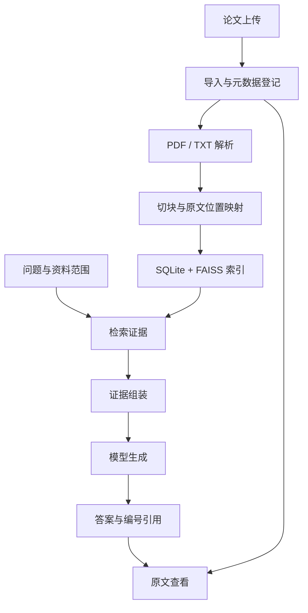

# Fiona（曌）：项目开发文档

更新日期：2026-10-17。本文维护项目背景、版本范围、架构、模块边界、技术选择、数据结构、接口及验收约定。当前进度、可用命令、下一步与教程索引统一在 [README](README.md)；开发流程与排错放在专题教程；Agent 的工作及文档交付要求见 [AGENT.md](AGENT.md)。完整职责划分见 [README 文档导航](README.md#文档导航与职责)。

本文同时包含现有实现遵循的约定与待实现设计。设计表格和格式示例不表示功能已完成，实际能力以代码、验证结果和 README 状态为准。技术约定变化时修改本文件，再同步相关教程与入口说明。

## 1. 项目背景与目标

Fiona（曌）是面向时空预测研究的论文知识库与问答工具。中文名采用本项目的命名意象：**日月代表时间，空代表空间**；英文名使用 Fiona，表达面向时空研究的个人知识助手定位。

研究主方向为**时空预测**，覆盖交通与气象等应用，以及图神经网络等建模方法。图神经网络是方法维度，交通和气象是应用维度；论文登记同时保留这两个维度，便于按问题选择资料。

项目服务于持续阅读时空数据论文、理解研究问题和方法、核对实验结果以及梳理文献关系的工作。用户导入论文，以中文或论文原文中的术语提问，系统从已收录资料中检索依据，回答并给出论文、章节和实际 PDF 页码，便于回到原文核对。论文可以包含英文，正文与专有名词保留原文；中文解释不改变原文条件和结论强度。

首版先解决两个具体问题：**理解一篇论文的方法，以及查找有完整实验条件的事实。** 例如：

- “这篇论文解决什么问题，如何同时处理时间与空间信息？”
- “表中的某项结果对应哪个数据集、任务、指标和实验设置？”
- “论文明确提到了哪些假设和局限？”

答案示例（占位内容仅说明结构）：

> 根据《〔论文标题〕》的〔章节〕，作者使用〔原文方法〕建模〔时间/空间依赖〕，适用条件为〔原文限定〕。[1]
>
> [1] 〔论文标题与版本〕，PDF 第〔物理页码〕页，〔章节或表格编号〕。

没有证据时说明已收录材料不足；不能从模型记忆补出论文结果。作者明确陈述、综述或引用的转述，以及系统基于证据的推断应分清；方法在一个基准上的结果不能泛化为所有场景的结论。

学习目标为亲手搭建 Agent + RAG 应用，将 CS224N 的检索、Transformer、负采样和训练知识落实到代码。最终交付可运行网页、独立解析与检索模块，以及结构增强和重排训练的可验证改良。


## 2. 功能范围与版本安排

|版本|用户得到的能力|开发重点|
|---|---|---|
|V0.1：可用首版|导入 PDF/TXT、查看资料状态、单篇方法解释、实验事实查询、来源查看和缺资料提示|用选定论文跑通完整链路，方法和实验问题均有可定位依据|
|V0.2：比较与结构增强|跨论文比较、简单结果计算、复杂表格引用|论文 PDF 结构保留、混合检索、现成重排与有限工具调用|
|V0.3：模块改良|改善方法、数据集、任务和实验设置的混淆；按场景追溯引用原文|论文困难负例重排训练；可选文献链与证据精简|

两项主改良为“PDF 结构保留”和“困难负例重排训练”，使用时空研究论文数据。文献链与证据精简是可选扩展，默认关闭；无需先训练重排模型才做网页。

首版以论文文档为证据。自动抓取全网文献、运行论文原始时空数据集、训练论文中的预测模型、多租户与全量知识图谱不在当前范围内。原始数据集论文可以收录，实际数据计算另按明确需求扩展。

## 3. 页面与用户流程

### 3.1 知识库管理页

- 上传 PDF/TXT，补充论文标题、作者、年份、发表渠道、版本和来源；未知项留空。
- 资料列表展示标题、类型、年份、页数、导入状态与失败原因。
- 导入后可查看原文；失败可重试。问答仅使用完成索引的资料。
- 已索引的相同文件返回现有记录；失败文件重新上传时复用文档 ID，清理未完成产物后重试。

V0.1 按钮触发同步导入，显示处理状态，暂不建设后台任务平台。

### 3.2 问答页

用户选择资料范围 → 输入问题 → 检索证据 → 生成答案与引用 → 打开对应 PDF 页或 TXT 原文。使用 Streamlit 布局，展示论文标题、章节和位置；实验事实同时展示必要设置。

V0.1 每次按独立问题处理，不依赖历史对话自动补出论文或实验设置。来源不足、解析失败、服务超时分别提示。比较与计算上线后展示输入证据、适用条件、公式和结果。

## 4. 系统架构与模块责任



V0.2 在检索中加入 BM25、融合与重排，在生成前接入有限比较/计算工具；V0.3 可启用文献链。关闭扩展后仍能走基本问答链路。

|模块|输入 → 输出|责任|
|---|---|---|
|`ingestion`|文件与来源 → 文档记录|保存、hash 去重、状态更新、失败处理|
|`parsing`|文件 → 页面/段落/表格块|文本与物理页码；增强版处理双栏阅读顺序、章节、表格与公式附近文本|
|`chunking`|解析结果 → 证据块|章节上下文、原文位置映射、定义与实验限定绑定|
|`storage`|文档/块/向量 → 持久化记录|SQLite、FAISS 与块 ID 映射、重启加载|
|`retrieval`|问题与范围 → 排序证据|dense 召回与资料过滤，随后加入 BM25、RRF 与重排|
|`generation`|问题与证据 → 答案和引用 ID|API 适配、提示词、结构化响应、引用 ID 检查|
|`agent`|比较/计算任务 → 工具结果|V0.2 的有限检索和计算流程；V0.1 单次 RAG|
|`api / app`|用户操作 → 页面结果|API 接线、导入、问答、原文预览和错误状态|

OCR、预训练模型和向量索引使用现成实现；证据格式、切块、检索组装、工具流程与后续训练循环由项目自行实现。LlamaIndex 可作原型参考，不作为必需框架。

## 5. 技术方案

技术路线保持不变。候选组件到对应开发阶段再安装，实际依赖与版本以工程配置和验证结果为准。

|组件|实施选择|用途|
|---|---|---|
|语言与服务|Python + FastAPI|核心管线与 HTTP API|
|界面|Streamlit|资料管理、问答、原文查看|
|基础解析|PyMuPDF / Python 文本读取|PDF 逐页文本与 TXT 段落|
|结构增强|Docling + 自建结构切块|阅读顺序、表头、章节与证据限定|
|Embedding|`BAAI/bge-m3`，先用 dense 模式|问题与中英文论文证据块向量；接入时验证实际召回质量|
|向量索引|FAISS 精确内积，向量归一化|本地检索与索引持久化|
|关键词检索|`rank-bm25` + 中英文适配分词|V0.2 补充术语、缩写和精确名称检索|
|融合与重排|自写 RRF + `BAAI/bge-reranker-v2-m3`|先用现成权重，V0.3 接自己的训练权重|
|生成模型|可配置的 DeepSeek 或 Qwen API|从环境读取 `base_url / model / api_key`|
|存储|SQLite + JSONL + 本地文件|文档、块、解析与索引|
|训练|PyTorch|困难负例数据加载、损失、优化与权重保存|

用法参考 [BGE-M3 模型卡](https://huggingface.co/BAAI/bge-m3)、[FlagEmbedding 重排说明](https://github.com/FlagOpen/FlagEmbedding/blob/master/examples/inference/reranker/README.md)和 [Docling 文档结构](https://docling-project.github.io/docling/reference/docling_document/)。模型 ID、依赖兼容性、输入长度与 batch 在接入时核验，不提前绑定未经验证的运行参数。

已有 4090 可用于 embedding 和重排推理，A800 用于后续训练；具体显存与批量大小实测确定，基础开发不等待训练环境就绪。

## 6. 数据与接口约定

### 6.1 论文语料准备与来源登记

主方向已确定为时空预测。**以下数量是重新提出的选材建议，不代表已有或已确认的论文清单；具体论文可按研究需要替换。**

先用 2 篇建立数据处理基线：交通预测方法 1 篇、气象预测方法 1 篇，分别检查正文、方法、实验表格与引用定位。第一篇即可用于实现切块；不必等待整套语料齐备。随后扩展到首批共 8 篇，前面的 2 篇包含在总量内。

|论文角色|建议篇数|在知识库中的作用|核对重点|
|---|---|---|---|
|时空预测综述或问题定义|1|建立术语、任务和方法分类|与交通、气象或时空建模直接相关；区分转述与原文证据|
|交通预测方法|3|形成相关方法的比较和困难负例|时间/空间依赖、图构建、任务、数据划分、预测步长与指标|
|气象预测方法|3|验证另一类时空预测文档与实验条件|变量、空间网格、时间分辨率、预报时效、真值与评测设置|
|数据集或评测基准论文|1|解释结果成立的条件和可比性|数据版本、采样、切分、指标定义和评价协议|
|合计|8|形成首批可人工核对的小型论文语料|按独立论文计数，不把预印本、发表版和补充材料重复计篇|

这是围绕用户所选方向提出的工程规模建议，不是领域覆盖率或效果保证。初批以正文完整、来源清楚、问题可核对为准；交通与气象资料分别保留评测条件，不直接横比不同任务的数值。

可供选材的已核对入口示例（2026-10-15 查阅，尚未下载或登记为语料）：

- 交通图建模可从 [STGCN（IJCAI 原论文页）](https://www.ijcai.org/Proceedings/2018/0505)或 [DCRNN（作者预印本记录）](https://arxiv.org/abs/1707.01926)开始，具体版本按实际获取文件登记。
- 气象方法可考察 [GraphCast（Science 论文记录）](https://doi.org/10.1126/science.adi2336)和 [Pangu-Weather（Nature 原论文页）](https://www.nature.com/articles/s41586-023-06185-3)。
- 评测条件可考察 [WeatherBench 2（作者机构论文页）](https://research.google/pubs/weatherbench-2-a-benchmark-for-the-next-generation-of-data-driven-global-weather-models/)。这里收录的是基准论文，不要求下载或运行气象原始数据。

以上用于确定选材起点，不构成完整的 8 篇名单。综述、其余方法和是否调整应用配比留到实际选材时决定；当前收录进度只在 README 和来源清单维护。

资料优先从论文作者、会议或期刊页面、机构仓库和预印本记录等可核对来源获取。预印本与正式发表版记录具体版本；同一论文重复下载不计为独立论文，内容不同的版本分开保存并建立关联。题目、年份、作者、DOI 等以实际来源为准，未知项留空，不从文件名猜全。

`configs/pdf_files.json` 只负责 `doc_id → PDF 文件名` 映射。论文清单独立建立；登记后先用 `--doc-id` 指定处理，运行前核对配置中的实际语料范围。

来源清单使用 `data/source_manifest.jsonl`，每行一个 JSON 对象。以下为未来论文登记的格式示意，所有占位内容均需替换，不代表已存在论文：

```jsonl
{"doc_id":"paper_example_v1","title":"〔实际论文标题〕","doc_type":"research_paper","language":"en","source_url":null,"attachment_url":null,"published_at":null,"downloaded_at":null,"raw_path":"data/raw/paper_example_v1.pdf","sha256":null,"status":"planned","related_doc_ids":[],"metadata":{"authors":[],"year":null,"venue":null,"doi":null,"arxiv_id":null,"version":null,"paper_role":null,"research_topic":null},"notes":"格式示意，尚未选材"}
```

- `source_url` 记录具体论文页，`attachment_url` 记录 PDF 地址，日期未知为 `null`；下载时间与论文发表时间分开。
- `metadata.paper_role` 表达论文角色，具体取值随选材确定；不为区分综述或方法而改变通用导入管线。
- `sha256` 为实际文件校验值；来源页与附件路径变化不代替内容去重。
- `planned → downloaded → parsed → indexed` 表示文档处理进度；失败用 `failed` 并记原因，问答只使用 `indexed`。
- `related_doc_ids` 记录已确认的关联文档，具体版本与引用区域在文献链扩展中表达。

原文位于 `data/raw/`，页面结果位于 `data/parsed/`，证据块位于 `data/chunks/`，索引统一位于 `data/indexes/`。TXT 继续支持，必要时用作核对过的文字材料，不以摘要代替完整论文。

`data/sample_questions.jsonl` 保存问题、人工核对答案、`doc_id`、`source_regions`、必要实验条件和单位。先核对一个方法解释和一个实验事实，逐步加入比较、计算及缺资料问题，记录引用错页、条件遗漏和版本混淆等真实失败。

### 6.2 最小数据结构

|对象|首版必要字段|
|---|---|
|文档 `Document`|`doc_id, title, doc_type, source_url, raw_path, sha256, status, metadata`|
|证据块 `Chunk`|`chunk_id, doc_id, text, section_title, source_regions`|
|原文位置 `SourceRegion`|PDF：从 1 开始的 `page_number`，可选 `bbox`；TXT：`char_start / char_end`，左闭右开|
|检索结果 `Evidence`|`chunk_id, text, source_regions, score`|
|回答 `Answer`|`request_id, status, answer, citations, calculation`|

论文使用 `doc_type=research_paper`；通用文档字段不绑定领域。作者、年份、渠道、DOI、预印本 ID、版本与研究主题放入 `metadata`，未知项为空。元数据持久化在实现时按该契约接入。

`doc_id` 标识固定内容的一份文档版本；内容修订建立新记录，相同内容重新解析复用 ID。不同版本不得静默覆盖或合并。章节路径可保存为块的 `metadata.section_path`；PDF 可以附印刷页码，但打开原文始终用物理页序。

实验表格保留表名、方法行名、数据集或任务列头、数值、单位、评价方向、实验条件和必要脚注。增强版可用 `table_id / row_header / column_header / method / dataset / task / metric / original_value / original_unit / setting / notes` 表达，未知项留空。适用时补充预测步长、采样间隔、空间范围与数据划分；不把缺失条件补成默认值。

公式与定义保留编号、变量说明和上下文；抽取错误时标记待处理，不凭模型补写数学表达式。双栏、跨页表格与脚注需要核对阅读顺序。空白、破折号与 N/A 不当作零；百分比、百分点和相对改善分别处理。相同指标缩写不自动表示相同定义或可比协议。

### 6.3 首版 API（待实现）

|接口|作用|
|---|---|
|`POST /documents`|上传 PDF/TXT 和来源字段，可选 `force_rebuild=false`；同步导入，返回 `doc_id / status / message`|
|`GET /documents`|返回资料列表与状态|
|`POST /query`|接受问题和可选资料范围，返回答案、引用或明确错误|
|`GET /sources/{doc_id}/pages/{page_number}`|返回指定 PDF 页预览|
|`GET /sources/{doc_id}/text?start=…&end=…`|返回 TXT 原文区间|

请求格式示意，示例 ID 尚未登记，不能作为当前命令调用：

```json
{
  "question": "这篇论文如何建模时间和空间依赖？",
  "doc_ids": ["paper_example_v1"]
}
```

解析或切块规则变化时 `force_rebuild=true` 重建该文档的块和索引映射。重建期间该文档不参与查询，完成后替换产物并标记 `indexed`，失败记录原因；其他文档继续可用。该流程在实现时需验证，不把现有解析脚本视为已经支持完整重建。

`doc_ids` 不传时查询全部已索引资料。引用包含 `citation_id / chunk_id / doc_id / title / source_regions`；版本和章节可从元数据补充。模型只返回提供的证据 ID，原文位置由程序填入。

回答状态为 `answered / insufficient_evidence / needs_clarification / error`。引用 ID 存在仅证明来源可打开，是否支持结论仍需核对，不将相似度分数当作正确率。

V0.2 的比较先核对任务、数据版本与划分、指标定义、时间/空间范围及其他相关设置。条件不同可以陈述差异，不能直接宣称某方法整体更优。计算用 `Decimal`，保存输入证据、公式、结果、单位与舍入位数；缺数据、除零或设置不可比时明确提示。Agent 最多拆成三个子任务，证据不足最多追加一次检索；工具不执行模型生成的任意代码。

### 6.4 页面解析与批量输出约定

现有解析器与脚本继续使用，复现见 [PDF 解析教程](docs/development/02-PDF解析.md)。

- 配置只读，不自动扫描目录或修改来源清单。每份 PDF 输出一个 UTF-8 JSONL，每行一页，包含 `doc_id / page_number / text / status`，默认保留空文本页。
- 页面 `status=extracted / empty` 与文档处理状态分开。`empty` 附 `reason`，不自动认定为空白页或扫描页；默认不执行 OCR。
- 文本统一换行符，行内连续空白压成一个空格，去掉行首尾空白，将多个空行压成一个空行；保留段落边界，默认不启用英文断词拼接。
- 当前使用 `get_text("text", sort=True)`；排序和空白清洗不保证双栏阅读顺序、表格与公式正确。每篇论文均需核对解析质量。
- 单文件先写临时输出，全部页面提取完成后替换正式文件。打开或解析异常时保留旧正式输出，清理临时文件并继续其他文档。
- 全部页面为空时仍会保存本次页面记录并报告文件失败，因此全空结果可能替换旧 JSONL，不能仅凭文件存在判断成功。
- `--doc-id` 选择子集；`--keyword` 只影响预览，不过滤写入页面。文件处理有失败时最终返回 1，配置或参数错误返回 2。

### 6.5 首版切块约定（待实现）

输入为选定论文的 `data/parsed/<doc_id>.jsonl`，输出为 `data/chunks/<doc_id>.jsonl`。逻辑放在 `src/fiona/chunking/`，计划入口为 `scripts/chunk_text.py`；实现并验证后再在 README 发布命令。

1. **正文：** 优先按段落与章节合并，以 600～1000 个字符作为起始目标范围；过长段落再按句子拆分，相邻块可重叠约 100 个字符。短块允许低于目标范围，不为凑长度混入无关主题。中英文字符数仅为起始启发式，接入 embedding 时再检查 tokenizer 长度与检索效果。
2. **位置：** 第一版在单页内切分，跳过空文本页但保持原页码。后续跨页合并记录全部 `source_regions`。
3. **表格：** 小表优先整体保留，可超过正文目标长度；长表按对应关系明确的行组分段，为每段补上必要表头、条件和脚注。不靠固定重叠代替实验限定。列含义不明确时记录待处理位置，不猜测。
4. **上下文：** 可靠识别时填写 `section_title`，否则为 `null`。方法定义、公式及变量说明尽量保留在一起；跨页或解析缺失时记录限制，不伪造补全。
5. **标识：** 沿用第 6.2 节 `Chunk` 结构。同一输入和配置产生可复现的块 ID；规则改变允许重建 ID 与索引，不将块 ID 当作永久原文区域 ID。

示意结构，论文 ID 和正文为占位内容：

```json
{
  "chunk_id": "paper_example_v1_p0004_c001",
  "doc_id": "paper_example_v1",
  "text": "〔包含方法或实验限定的论文原文〕",
  "section_title": "〔实际章节标题〕",
  "source_regions": [{"page_number": 4}]
}
```

验收检查非空文本、唯一 ID、原文可定位与重跑可复现；方法问题保留定义与必要上下文，实验问题保留指标、结果、数据集与设置。记录单页切块的跨页限制；人工核对样例写入 `data/sample_questions.jsonl`，关键词命中不能代替正确性核验。

## 7. 代码组织与运行约定

以下为目标目录，包含现有文件与规划路径。实际状态查 README，按需要创建，不批量生成空模块。

```text
Fiona/
  README.md
  项目开发文档.md
  AGENT.md                       # 完整 Agent 工作规则
  AGENTS.md                      # 读取入口
  1.环境搭建.md                  # 已有环境教程
  pyproject.toml
  requirements.lock.txt
  .env.example
  configs/pdf_files.json
  configs/default.yaml           # 规划中的运行配置
  scripts/parse_pdf.py
  scripts/chunk_text.py           # 规划中的切块入口
  src/fiona/
    ingestion/
    parsing/
    chunking/
    storage/
    retrieval/
    generation/
    agent/
    api/
    cli.py
  app/streamlit_app.py
  training/
  data/{raw,parsed,chunks,indexes}/
  data/source_manifest.jsonl
  data/sample_questions.jsonl
  docs/development/
    02-PDF解析.md
  docs/templates/功能开发文档模板.md
  docs/demo_cases.md
```

使用已有 Conda `fiona` 环境。依赖声明以 `pyproject.toml` 为准，版本快照在 `requirements.lock.txt`；新增依赖核对 Python 兼容性后再安装。不因技术方案列出组件而提前安装。

真实密钥仅放本地 `.env`；示例变量与读取代码一致后才能作为可用配置发布。解析、证据块和索引需要持久化，避免每次启动重建。索引统一为 `data/indexes/`；工作区的旧拼写 `data/indexs/` 在实现索引时核对迁移，不形成两套路径。

后续 CLI 提供 `ingest / ask`；验证通过的常用命令写入 README，完整参数、过程与排错放在专题教程，不把规划命令当成当前入口。

## 8. 两项改良与 CS224N 的实际使用

### 8.1 论文 PDF 结构保留

V0.1 跑通后，根据真实错误增强 `parsing / chunking`：

1. 使用结构解析器保留双栏阅读顺序、标题、段落、表格、图表说明及公式附近文本。
2. 表格按行组切块，重复必要的行列头、数据集、指标、设置与脚注。
3. 公式编号、变量解释与方法上下文绑定；跨页内容仅在对应关系明确时合并。
4. 证据包用于回答，引用仍回到原始 PDF。无法可靠解析的图或公式明确限制，不猜测内容。

验收用同一问题检查必要条件是否完整、原文是否可定位，并记录改良前后的具体结果；不要求自行训练 OCR 或布局模型。

### 8.2 论文困难负例重排训练

从实际检索失败构造负例：同一方法不同数据集、相同数据集不同任务或划分、相近方法名、不同预测步长、不同指标、消融实验与主结果混淆，以及预印本与发表版差异。只有与选定研究方向相关且确实出现的混淆才加入样本。

每个样本包含问题、支持答案的正例与容易混淆的负例；其他合法证据不误标为负例。在 `training/` 编写数据加载、分组打分、组内交叉熵损失、优化循环和权重保存，以预训练 cross-encoder 初始化。训练资料与最终验证问题隔离，防止同一证据近重复泄漏。

训练后接回相同重排接口，用未参与训练的问题检查混淆是否减少、普通问题是否退化。取得真实结果后才写改善数字。方法参考 [BERT 段落重排](https://arxiv.org/abs/1901.04085)与 [FlagEmbedding 重排训练](https://github.com/FlagOpen/FlagEmbedding/blob/master/examples/finetune/reranker/README.md)。

|CS224N 知识|项目中的实践|
|---|---|
|向量与相似度|理解问题/证据 embedding，以及语义接近仍可能混淆实验条件|
|BERT 与 Transformer|理解 bi-encoder 召回、cross-encoder 重排与输入截断|
|反向传播、损失与优化|实现训练循环，检查 loss、梯度与 checkpoint|
|负采样与迁移学习|用真实检索错误构造困难负例，适配已有模型|

手写 attention 或小型 Transformer 可作个人练习，不作为本应用的前置任务。时空建模论文中的算法研究与本项目的检索训练分别记录，不把阅读模型等同于复现该模型。

### 8.3 可选：文献链与证据精简

基础问答完成且已有真实引用关系时，先支持“当前论文的明确引用 → 已收录被引论文的原文区域”的一跳定位。引用只表示作者引用了该文献，不保证被引论文支持当前作者的全部结论。

复用 `doc_id` 和 `SourceRegion`，以文档版本及原文区域构造稳定 `region_id`，不以变化的块 ID 代替。SQLite 保存 `reference_nodes`、`reference_edges` 与歧义候选 `reference_candidates`。

关系包含 `explicit_cites`、`qualifier_for`、`contains`。引用编号需结合本篇参考文献表匹配作者、标题、DOI 或预印本 ID；同名、同年或关键词共现不直接确认关系。不同版本分开保存。

|计划模块|职责|
|---|---|
|`parsing/references.py`|提取文内引用、参考文献条目、DOI/URL 与引用发生位置|
|`storage/reference_graph.py`|保存节点、边、候选和确认状态|
|`retrieval/reference_expansion.py`|匹配已收录论文，从已确认关系最多扩展一跳并定位原文|
|`retrieval/evidence_compaction.py`|保留限定条件，合并本次重复证据并记录来源路径|

仅匹配到文件时只记录文件级关联；目标未收录、版本不明或定位有歧义时明确说明，不能声称已阅读原文。表头、脚注和变量说明属于证据限定，不计作跨论文一跳。

精简只影响本次上下文，不删除原始资料、引用关系或版本。相同区域重复召回可合并，但不同方法、数据集、协议、版本和冲突结论不得当作重复删除。首轮不生成压缩摘要；必要条件装不下时缩小回答范围或说明缺失。

验收：从引用打开已收录原文，必要限定完整，缺失与歧义明确提示，重复证据可展开来源路径，关闭后基本问答仍正常。

## 9. 交付与展示

V0.1 要能在新会话加载资料，通过网页完成导入、方法解释、实验查询、引用查看与缺资料提示。README 提供可用入口和教程索引；专题教程提供完整步骤。用少量人工核对问题验证，不以题目数量代替证据质量。

**每个独立功能必须同时交付可运行实现、适当验证及一份非常详细的开发流程或技术要点文档，深度参照 [1.环境搭建.md](1.环境搭建.md)。** 完整规则见 [AGENT.md](AGENT.md#5-每完成功能必须交付详细文档)，使用[模板](docs/templates/功能开发文档模板.md)。修复或扩展同步更新原教程。

后续成果包括结构增强、比较/计算、自写重排训练与可加载权重，以及改良前后的真实案例。演示流程：导入论文 → 问方法或实验 → 查看原文 → 比较相关论文 → 在可比条件下计算 → 展示结构或重排修复案例。有被引论文时再展示文献链；方案与计划不能当作已完成成果。

## 10. 按需参考

沿用工程参考：[RAGFlow](https://github.com/infiniflow/ragflow)、[Langchain-Chatchat](https://github.com/chatchat-space/Langchain-Chatchat)、[QAnything](https://github.com/netease-youdao/QAnything)、[LlamaIndex](https://github.com/run-llama/llama_index)、[FAISS](https://github.com/facebookresearch/faiss)、[FlagEmbedding](https://github.com/FlagOpen/FlagEmbedding)。[GraphRAG](https://github.com/microsoft/graphrag)仅作可选文献链参考，不要求建设全量知识图谱。

时空预测论文的候选入口与分层数量建议见第 6.1 节，实际清单逐项核对来源后登记。
